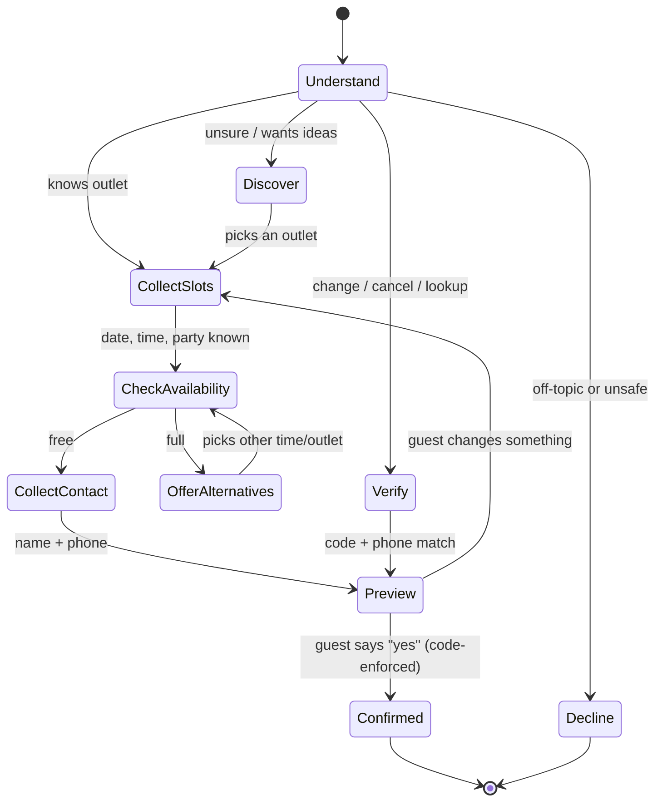

# Use Case: "Gia" — Conversational Reservations & Demand Intelligence for GoodFoods

> Part 1 of the GoodFoods challenge: solution design and business strategy.
> Financial inputs are either sourced from published industry data (§15) or marked as assumptions to be replaced by GoodFoods' own baseline in Phase 0 (§10). The working is shown so every number can be checked.

---

## 1. Summary

| | |
|---|---|
| **Client** | GoodFoods — 75 casual- and fine-dining outlets across 12 Bengaluru neighbourhoods, 13 restaurant concepts |
| **Use case** | A conversational agent ("Gia") that lets guests discover the right outlet, check live availability, and book / change / cancel tables — on web chat first, then WhatsApp and phone voice |
| **Model** | A small open-weight model behind any OpenAI-compatible endpoint: `gpt-oss-20b` on Groq today (Groq retired Llama 3.1 8B in Aug 2026), Llama 3.1 8B via Ollama or vLLM on own hardware |
| **Architecture** | From-scratch agent loop → MCP tool server (JSON-RPC 2.0) → deterministic reservation engine → SQLite (Postgres/POS adapters in production) |
| **One-line pitch** | Every guest who wants to eat at GoodFoods gets a table *at GoodFoods* — even when their first choice is full. |

## 2. Problem statement

**What the client said:** "Streamline reservation management."

**What an immersive audit typically finds behind that sentence** (hypotheses to verify in Phase 0 by shadowing hosts during Friday/Saturday peak and reading call logs):

1. **Peak-hour phone congestion.** Hosts juggle walk-ins, seating and the phone between 7:30–9:30 PM — the exact window when most booking calls arrive. Unanswered calls are lost covers, usually to a competitor.
2. **Each outlet is an island.** When Tandoor House Indiranagar is full, the host says "sorry". Nobody checks that the Tandoor House 2 km away in MG Road has a free 6-top. Demand leaks out of the chain.
3. **No first-party guest relationship.** Bookings coming via aggregators belong to the aggregator (and carry fees). GoodFoods doesn't know its regulars, their preferences, or their anniversaries.
4. **No-shows and late changes** are expensive because changing a booking is friction (call again, wait on hold), so people just don't show up.
5. **Unmet demand is invisible.** "We turned away 40 parties of 6 in Whitefield last Saturday" is not recorded anywhere — so capacity and expansion decisions are made on gut feel.

### Goals

| Horizon | Goal |
|---|---|
| **Short term (0–3 months)** | Answer 100% of reservation requests instantly, 24×7; deflect ≥60% of booking calls from hosts; recapture overflow demand within the chain. |
| **Long term (3–12 months)** | Own the guest relationship (first-party CRM), cut no-shows, use captured demand data for yield management and expansion decisions, and productise the platform for other chains. |

## 3. Use case description

A guest messages Gia in natural language ("anniversary Saturday, 2 of us, around 8, not too loud"). Gia, a small open-weight model that decides the intent itself and calls tools over MCP, recommends 2–3 outlets with reasons, checks live table inventory, and books once the guest says "yes". If the slot is full, Gia offers the nearest free times **and** sister outlets nearby that can seat them. Existing bookings can be found, changed or cancelled after verifying the confirmation code + phone number.

**In scope (v1):** discovery & recommendation, availability, booking, lookup, modification, cancellation, large groups up to 20 (private dining), multilingual text.
**Out of scope (v1):** payments/deposits, food pre-orders, loyalty points, delivery. (See §11 — several of these are Phase 3 opportunities.)

## 4. Users & stakeholders

| Stakeholder | What they care about | What Gia gives them |
|---|---|---|
| **Guests** (couples, families, office groups, tourists) | Fast answer, right vibe, certainty the table exists | Instant, 24×7, multilingual booking with reasons for each suggestion |
| **Outlet managers & hosts** | Fewer calls at peak, accurate covers forecast | Calls deflected; bookings land in the same book they already use |
| **COO / Head of Operations** (economic buyer) | Table utilisation, no-shows, staff cost | Utilisation and overflow-capture dashboards |
| **Marketing / CRM** | Repeat visits, owned guest data | Phone-keyed guest profiles, occasion dates, opt-in re-engagement |
| **Events / banquets team** | High-ticket group leads | 9–20 guests routed to private dining; >20 handed off as a lead |
| **Finance** | ROI, aggregator fees | Cost per booking, direct-vs-aggregator mix |
| **IT / Security** | Integration effort, data protection (DPDP Act 2023) | MCP adapter pattern, masked PII, audit log, self-hostable model |

**Potential customers beyond GoodFoods:** multi-outlet casual-dining and QSR-plus chains in India (10–200 outlets), hotel F&B groups, mall food-and-entertainment operators, and reservation-platform vendors who want an AI front-end (see §12).

## 5. Success criteria & metrics

| Layer | Metric | Target (pilot → scale) | How measured |
|---|---|---|---|
| **Business** | Booking-call deflection | ≥ 60% of booking calls | Call logs before/after |
| | Overflow capture — "slot full" conversations that end in a GoodFoods booking elsewhere/another time | ≥ 40% | `NOT_AVAILABLE` events → later `confirmed` in same session |
| | No-show rate on agent bookings | −15% relative to baseline (reminders are associated with ~16% fewer no-shows) | POS seated vs booked |
| | Cancelled covers refilled | ≥ 10% | Cancellation → new booking for the same slot |
| | Direct (non-aggregator) share of reservations | +15 pts | Reservation source |
| | Guest CSAT (post-visit 1-tap) | ≥ 4.5 / 5 | WhatsApp survey |
| **Conversation** | Booking completion rate (booking-intent sessions → confirmed) | ≥ 70% | Agent trace |
| | Containment (no human hand-off) | ≥ 85% | Hand-off events |
| | Median turns to book | ≤ 5 | Agent trace |
| **Model / system** | Tool-selection accuracy on eval set | ≥ 95% | `evals/run_evals.py` |
| | Unconfirmed writes | **0, always** (hard gate) | Eval + audit log |
| | Invented confirmation codes reaching a guest | **0** (hard gate) | Guard events |
| | p50 / p95 response time | < 2.5 s / < 6 s | Trace latency |
| | LLM cost per completed booking | < ₹1 | Token usage × price |

## 6. ROI model

Every input is either **sourced** (published industry data, listed in §15) or an **assumption** to be replaced by GoodFoods' own data in the Phase 0 audit. The published figures come mostly from US/UK operators and from vendors who sell phone or booking software, so they are treated as ranges, not facts about Bengaluru. Revenue is converted to **contribution** (revenue minus variable food and service cost), because incremental covers use existing staff and rent.

### 6.1 Inputs

| Input | Conservative | Base | Basis |
|---|---|---|---|
| Phone calls per outlet per day | 40 | 40 | Assumption — measure in audit |
| Share of calls that are reservations | 38% | 38% | Sourced: 1.2M-call study of US restaurants (Maple) |
| Reservation calls missed | 15% | 25% | Sourced range: US vendor studies report ~33–36% missed at peak (Maple, Hostie); we use lower figures for all-day traffic |
| Missed callers who would have booked | 40% | 40% | Assumption |
| Missed bookings Gia recaptures (web/WhatsApp now, voice in Phase 2) | 30% | 60% | Assumption |
| Booking calls deflected from hosts | 50% | 60% | Assumption |
| Host handling time per call · loaded cost | 3.5 min · ₹250/h | 3.5 min · ₹250/h | Assumption |
| Reserved covers per outlet per day | 60 | 60 | Assumption |
| No-show rate | 2.3% | 3.7% | Sourced: 3.8M reservations, UK-heavy (resOS); ~50 US full-service locations (Bloom Intelligence) |
| No-show reduction from reminders | 16% | 16% | Sourced, observational association (resOS) |
| Cancellation rate | 15% | 15% | Sourced (Bloom Intelligence) |
| Cancelled covers refilled thanks to earlier self-serve cancellation | 5% | 10% | Assumption |
| No-show seats resold | 50% | 50% | Assumption |
| Party size · spend per cover | 3 · ₹750 | 3 · ₹750 | Assumption |
| Contribution margin on incremental covers | 60% | 60% | Assumption — confirm with GoodFoods finance |

### 6.2 Value per year (75 outlets × 365 days)

| Lever | Conservative | Base | How it's calculated (per outlet per day) |
|---|---|---|---|
| Host time freed (cost saving) | ₹30 L | ₹36 L | 15.2 reservation calls × 3.5 min × deflection × ₹250/h |
| Recaptured missed bookings (revenue) | ₹1.69 Cr | ₹5.62 Cr | 15.2 × missed × 40% × recapture × 3 covers × ₹750 |
| Fewer no-shows (revenue) | ₹23 L | ₹37 L | 60 covers × no-show × 16% × 50% × ₹750 |
| Refilled cancellations (revenue) | ₹92 L | ₹1.85 Cr | 60 covers × 15% × refill × ₹750 |
| **Total revenue** | **₹2.84 Cr** | **₹7.83 Cr** | |
| **Contribution (60%) + host saving** | **≈ ₹2.0 Cr** | **≈ ₹5.1 Cr** | |
| Overflow to sister outlets | not counted | not counted | Measured in pilot — upside only |

**What changed from the first draft:** the first draft assumed a 12% no-show rate. Published data puts it at roughly 2–4%, so the no-show lever is now small and the case rests on **missed calls** and **cancellations**, which are larger and better evidenced.

### 6.3 Cost and payback

| Year-1 cost (estimate) | Amount |
|---|---|
| Build, POS adapter, WhatsApp and telephony integration (one-time) | ₹25 L |
| Two engineers to run and improve it | ₹40 L |
| Hosting, messaging and voice minutes | ₹10 L |
| **Total** | **≈ ₹75 L** |

LLM cost is negligible at this scale. A booking conversation uses about 25,000 tokens; even at $0.50 per million tokens — well above typical hosted small-model rates (check the provider's current price) — that is about one US cent, roughly ₹1, per conversation.

**Payback:** about **4–5 months** in the conservative case and under 2 months in the base case. The single biggest uncertainty is the missed-call rate, so Phase 0 measures it first from GoodFoods' call logs; if it comes in under 10%, the case reduces to host time plus cancellations, and the pilot scope shrinks accordingly.

## 7. Conversation design

### 7.1 User stories

1. *As a couple planning an anniversary,* I describe the vibe and budget and get 3 options with reasons, so I can choose without browsing 75 listings.
2. *As a parent,* I ask for a kid-friendly place near home with parking for 5 tomorrow at 1 PM and book it in under a minute.
3. *As an office admin,* I book a private room for 14 on Friday, and if one outlet is full I'm offered the next best outlet instead of a "sorry".
4. *As a guest whose plans changed,* I move my booking from 8 PM to 9 PM or cancel it with my code + phone, without calling anyone.
5. *As a Hindi/Hinglish speaker,* I can just write the way I speak.

### 7.2 State machine

`Preview → Confirmed` is **not** an LLM decision: the agent executes every write as a dry run first and only performs the real write after a deterministic check that the guest affirmed *that exact* summary.

### 7.3 Personality, tone, languages

- **Gia** is warm, brief (< 90 words), and decisive — offers at most 3 options, each with a reason.
- Mirrors the guest's language: English, Hindi, Hinglish; Kannada/Tamil text works with the base model and improves with Indic fine-tuning (Phase 3); voice via Indic ASR/TTS (Phase 2).
- Never invents facts: outlets, availability, prices and codes come only from tools.

## 8. Bot features & integrations

| Capability | MCP tool | Notes |
|---|---|---|
| Search with hard filters | `search_restaurants` | cuisine synonyms (“dosa” → South Indian), area aliases (“ORR” → Marathahalli), auto-widens to neighbouring areas |
| Occasion-aware recommendation | `recommend_restaurants` | weighted scoring (cuisine, area proximity graph, budget fit, occasion features, rating) + human-readable reasons; ranks *bookable* venues first |
| Outlet details | `get_restaurant_details` | hours, seating, private room, dishes |
| Availability | `check_availability` | table-level inventory with 90-min sittings; alternatives ±3 h; sister outlets free now |
| Book / change / cancel | `make_reservation`, `modify_reservation`, `cancel_reservation` | declared non-read-only via MCP annotations → confirmation-gated |
| Lookup | `lookup_reservation` | phone-verified; identical error for wrong code vs wrong phone (no enumeration) |

**Production integrations:** POS / existing reservation book via an MCP adapter (no rip-and-replace), WhatsApp Business API, telephony + Indic speech, SMS/WhatsApp reminders, CRM/CDP, BI warehouse for demand analytics.

## 9. Key challenges & mitigations

| Challenge | Mitigation (implemented in the prototype unless noted) |
|---|---|
| Small model books without consent / on wrong details | Dry-run + exact-action confirmation gate in code |
| Small model invents confirmation codes | Output guard rejects any code not returned by a tool, forces regeneration |
| Calendar arithmetic ("next Friday") | Model passes what the guest said; deterministic parser resolves against server clock |
| Malformed tool calls (common with small models) | Salvage from text / Groq `failed_generation`; JSON-schema coercion; errors returned as fixable hints |
| Overbooking under concurrency | Allocation + insert inside one serialised DB transaction |
| PII & DPDP Act | Phone masked in every response; verification by code + phone; audit log; self-hostable model keeps data in India |
| Legacy reservation systems at outlets | Tool layer is an MCP server; swap the SQLite repository for a POS adapter without touching the agent (planned) |
| Staff adoption | Agent bookings appear in the host's existing book; hosts are trained as escalation, not replaced |

## 10. Rollout plan & timeline

| Phase | Weeks | Scope | Exit criteria |
|---|---|---|---|
| **0 · Immersive audit** | 0–2 | Shadow hosts at 4 outlets on peak nights; pull call logs, POS exports, no-show data; map the real booking path | Baseline for every §6 assumption; integration plan signed off by IT |
| **1 · Pilot** | 3–6 | 5 outlets (mixed concepts/areas), web chat + WhatsApp, POS adapter, daily eval runs | Completion ≥ 60%, zero unconfirmed writes, host NPS positive |
| **2 · Scale** | 7–12 | All 75 outlets; phone voice in Kannada/Hindi/English; reminders & 1-tap reschedule | Call deflection ≥ 60%, no-show −20% |
| **3 · Intelligence** | Q2 | Demand dashboard, off-peak yield nudges, guest CRM, LoRA fine-tune on anonymised transcripts, white-label packaging | Overflow capture ≥ 40%; first external chain signed |

## 11. Beyond reservations — non-obvious opportunities

1. **Lost-demand intelligence.** Every "full" response is a priced, located, timestamped demand signal (e.g. *"Saturday 8 PM, 6 guests, Japanese, Whitefield — 37 refusals this month"*). That turns into table-mix changes (more 6-tops), staffing plans, and **where to open outlet #76**. This data does not exist today.
2. **Chain-level overflow routing.** The agent already suggests sister outlets that can seat the guest. At chain scale this is a revenue-retention engine single-restaurant widgets cannot match.
3. **Yield management for tables.** Shift demand from 8 PM to 6:30/9:30 with targeted perks only when the 8 PM slot is predicted full — the same logic airlines use, applied to covers.
4. **High-ticket group & corporate pipeline.** Parties of 9–20 go to private dining; larger ones become qualified leads for the events team with date, headcount and budget captured.
5. **Owned guest relationship.** Phone-keyed profiles (veg, high chair, anniversary date) enable consent-based re-engagement ("Your anniversary is next week — your usual table at Skyline Grill?") and reduce dependence on aggregators.
6. **Voice-first, vernacular access.** A large share of Indian diners prefer calling over apps; the same MCP backend can sit behind a Kannada/Hindi voice line, turning the most congested channel into the most automated one.

## 12. Vertical expansion

The core is not "restaurants" — it is **recommend → check capacity → book a time-bound resource, with human confirmation**. Only the catalogue and the capacity rules change.

| Vertical | "Table" becomes | "Party size" becomes | Recommendation signals | Fit |
|---|---|---|---|---|
| Other restaurant chains (white-label) | tables | guests | cuisine, occasion, budget | Immediate — config only |
| Hotels F&B & banquets | halls, buffets | pax | event type, menu, décor | High |
| Salons & spas | chairs, therapists | services × duration | stylist, service, price | High |
| Clinics & diagnostics | doctors, machines | appointment length | specialty, insurance, distance | High (add consent & clinical safety layer) |
| Sports turfs, gaming, coworking rooms | courts, rooms | players / seats | location, amenities | High |
| Auto service centres | service bays | job hours | brand, service type | Medium |

**Packaging:** an MCP-native "Booking Agent Kit" — capacity engine + tool server + agent + eval harness — sold per location per month, with the demand-intelligence dashboard as the upsell.

## 13. Competitive landscape, build vs buy, and our advantages

### 13.1 Who GoodFoods could use instead

| Option | What it is | What it does well | Why it isn't enough for GoodFoods |
|---|---|---|---|
| **Zomato District** (dining out) | Zomato's going-out app: restaurant discovery, table booking and event tickets, launched November 2024 on a dine-out business of over $500M annualised order value | Huge consumer reach; brings new diners | The marketplace owns the guest relationship and the data. Its earlier dine-out payment programmes required 15–40% guest discounts and 4–12% commission per transaction, according to an NRAI advisory (2022). |
| **Swiggy's dine-out programme** | Swiggy's dining-out and table-booking offering | Same reach advantages as District | Same economics and the same NRAI concerns; the guest is Swiggy's customer, not GoodFoods'. |
| **EazyDiner** | Indian table-booking platform (founded 2014, Gurgaon) with discovery, deals and concierge | Reservation-first, established with premium diners | Still a marketplace; deals-led positioning; not GoodFoods-branded and doesn't route guests between GoodFoods outlets. |
| **OpenTable / SevenRooms** (global table-management and guest CRM) | Mature reservation books and guest profiles; SevenRooms is being acquired by DoorDash in a roughly $1.2bn deal announced May 2025 | Excellent table management and CRM | General-purpose, priced for US/UK markets, and SevenRooms is moving inside a delivery marketplace. Neither is built around Indian languages or a chain-wide AI front door. |
| **AI phone-answering vendors** (e.g. Maple, Hostie) | Voice agents that answer restaurant phones | Proven at cutting missed calls | US-focused and English-first; they answer calls, they don't run a chain's capacity or recommendations. |
| **Do nothing** (hosts + phone) | Current state | No integration cost | About a third of peak calls missed in published studies, no data on lost demand, no guest profile. |

### 13.2 Build vs buy

**Recommendation: keep the marketplaces as demand channels, build the direct channel.** District, Swiggy and EazyDiner bring new guests GoodFoods could not reach alone, so dropping them is unwise. But every repeat guest who books through them pays the platform's toll and stays the platform's customer. Gia is the **owned front door**: it handles repeat guests, phone and WhatsApp demand, and overflow between outlets, and it keeps the guest data. It does **not** replace a table-management system: the MCP tool server can sit on top of whatever reservation book GoodFoods already runs, including OpenTable or SevenRooms-style systems, through an adapter. That makes this an addition, not a migration, which is what makes it easy to say yes to.

### 13.3 Our advantages

1. **Enterprise-grade trust on a small, cheap model.** Safety lives in code, not in the prompt: server-declared write tools (MCP annotations), dry-run previews, exact-action confirmation, and a hallucinated-code guard. That is what makes a small model safe enough to own the booking flow — at a fraction of frontier-model cost and latency.
2. **One tool server, every channel.** Because the tools speak MCP, the same backend serves web chat, WhatsApp, voice, internal staff copilots and third-party agents. New channels are integrations, not rebuilds.
3. **Owned weights, India-resident data.** Open-weight Llama behind an OpenAI-compatible interface: no vendor lock-in, deployable on-prem or in an Indian region for DPDP compliance, and fine-tunable (LoRA) on GoodFoods' own conversations for vernacular quality.
4. **Chain brain, not a booking widget.** Overflow routing and lost-demand analytics only exist at chain level — the advantage compounds with every outlet added.

## 14. Assumptions & open questions

- City = Bengaluru; 75 synthetic outlets; hours, table mixes and ratings are generated deterministically for the demo.
- Single dining interval per day per outlet; 90-minute sittings; 30-minute slots; last seating 60 min before close.
- Parties ≤ 8 use one table (no table-joining yet); 9–20 require a private dining room; > 20 → events team.
- Identity = confirmation code + phone (no OTP in the prototype — add OTP for production).
- **Open questions for the client:** current reservation system/POS and its API; share of bookings by channel; measured no-show rate; deposit policy for large groups; languages by outlet catchment.

## 15. Sources

- No-show rates, reminders and deposits: [resOS No-Show Index 2026](https://resos.com/restaurant-no-show-rate/) — 3.8M reservations, Aug 2025–Jul 2026, UK-heavy
- No-show and cancellation rates by party size and channel: [Bloom Intelligence — Restaurant No-Shows in 2026](https://bloomintelligence.com/blog/restaurant-no-shows/) — ~50 US locations
- Missed calls and reservation share of calls: [Maple — The State of Restaurant Phone Communication](https://www.maple.inc/blog/the-state-of-restaurant-phone-communication-insights-from-1-million-calls) — 1.2M calls, US; vendor data
- Missed-call baseline: [Hostie AI 500k-call study](https://www.hostie.ai/resources/hostie-ai-500k-call-study-missed-calls-reduction) — vendor data
- Zomato District launch and dine-out scale: [Inc42 — Zomato rolls out District app](https://inc42.com/buzz/zomato-rolls-out-district-app-for-android-iphone-users/amp)
- Marketplace discount and commission concerns: [YourStory — NRAI cautions members against Zomato Pay, Swiggy Diner](https://yourstory.com/2022/09/zomato-swiggy-diner-discounts-restaurant-owners-interest-nrai/amp)
- EazyDiner profile: [PitchBook — EazyDiner overview](https://pitchbook.com/profiles/company/112121-11)
- SevenRooms acquisition: [Restaurant Online — DoorDash to acquire SevenRooms in $1.2bn deal](https://www.restaurantonline.co.uk/Article/2025/05/08/us-delivery-firm-doordash-to-acquire-hospitality-booking-platform-sevenrooms-in-12bn-deal)
